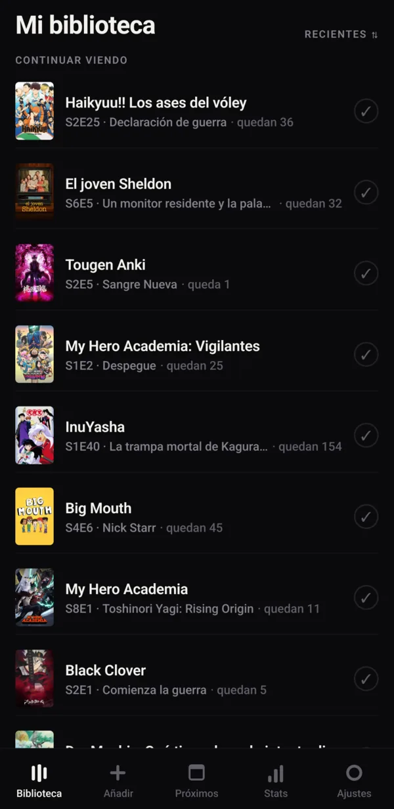
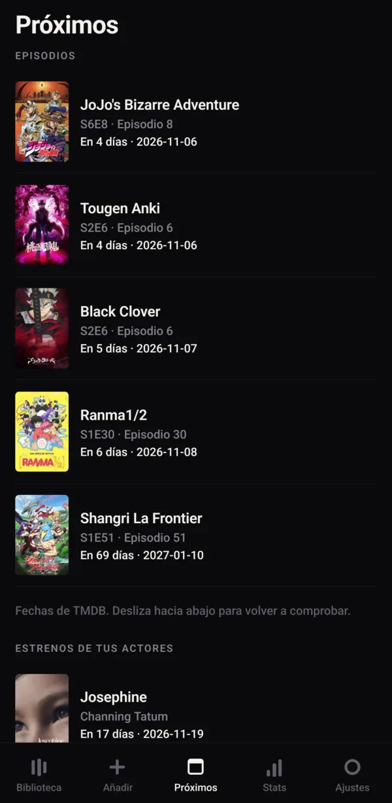
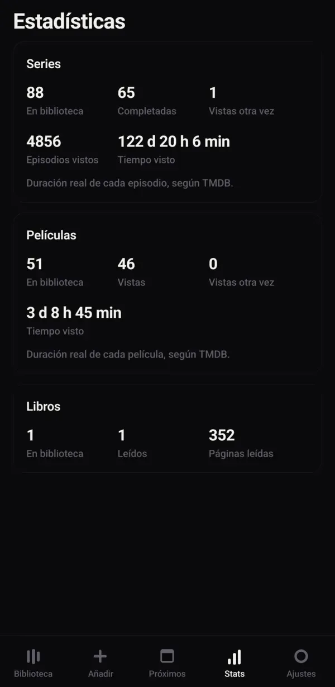

<div align="center">


# Ludok Time

**App Android para apuntar las series, películas y libros que ves y lees.**

Episodio a episodio, página a página, con fechas, notas y revisionados.<br>
Sin cuentas ni servidores: los datos viven en tu móvil y se copian a tu propio Nextcloud.

[](LICENSE)
[](https://www.android.com/)
[](https://docs.expo.dev/versions/v57.0.0/)
[](https://reactnative.dev/)
[](https://www.typescriptlang.org/)
[](https://www.sqlite.org/)
[](https://www.themoviedb.org/)

[Funciones](#funciones) · [Instalación](#instalación) · [Copias de seguridad](#copias-de-seguridad) · [Contribuir](#contribuir) · [Licencia](#licencia)

<br>

&nbsp;
&nbsp;


<sub>Biblioteca · Próximos · Estadísticas</sub>

</div>

---

## Índice

- [Por qué existe](#por-qué-existe)
- [Funciones](#funciones)
- [Qué sale del móvil](#qué-sale-del-móvil)
- [Instalación](#instalación)
- [Copias de seguridad](#copias-de-seguridad)
- [Desarrollo](#desarrollo)
- [Detalles de diseño](#detalles-de-diseño)
- [Historia](#historia)
- [Contribuir](#contribuir)
- [Licencia](#licencia)

## Por qué existe

Nació porque TV Time se cayó y con él se perdió un historial entero. Aquí la regla es **no perder
datos nunca**, y todo lo demás va después:

- Los datos viven en el almacenamiento privado de la app (`/data/data/com.ludok.time/`). No hay
  cuentas ni servidores propios.
- Copia de seguridad en JSON, exportable e importable en cualquier momento.
- **Copia automática a tu propio Nextcloud** al abrir la app estando en WiFi, un fichero por día.
- Aviso en la Biblioteca cuando llevas mucho sin copia.
- La capa de datos **se prueba de verdad** contra un SQLite real, no solo con tipos.

## Funciones

| Tipo | Fuente | Progreso |
|---|---|---|
| Series | TMDB | Episodio a episodio, con «ver siguiente» y el fotograma de cada uno |
| Películas | TMDB | Vista o pendiente, con fecha de visto y revisionados |
| Libros | Open Library, o a mano | Por página, con % leído |

**Biblioteca.** Filtros por tipo y por estado (viendo, viendo otra vez, pendiente, completado, en
pausa, abandonado), orden por recientes o por nota, «Continuar viendo» arriba y tus actores
favoritos debajo.

**Añadir.** Búsqueda en TMDB y en Open Library, y libros a mano para lo que no salga. Antes de
añadir se ve una **vista previa** con la ficha completa.

**Fichas.** Sinopsis, nota, estado y fechas. En series y películas, además:

- **Dónde verlo** en España (datos de JustWatch a través de TMDB), con un enlace que abre la
  búsqueda del título en cada plataforma.
- **También te puede gustar**: títulos parecidos, filtrados por idioma original para que un anime
  no recomiende series occidentales solo por compartir género.
- **Reparto**: los 12 primeros, por relevancia.

**Episodios.** Marcar uno, «hasta aquí» o una temporada entera; editar la fecha de visto. Si marcas
el 12 con el 1 al 11 sin ver, ofrece marcarlos también (y se puede pedir que no vuelva a
preguntar en esa serie). Solo se guardan episodios **ya emitidos**: TMDB devuelve las temporadas
enteras con los capítulos futuros dentro, y guardarlos dejaba el progreso clavado en 24/25.

**Próximos.** Cuándo sale el siguiente capítulo de cada serie que sigues, ordenado por lo que
llega antes, y debajo los estrenos de tus actores favoritos. Es una consulta en vivo a TMDB: una
fecha caducada guardada sería peor que no tenerla. Incluye las series **completadas** a propósito,
porque estar al día con una serie en emisión la deja como completada, y ese es justo el caso en el
que quieres saber cuándo sale el siguiente.

**Actores.** Tocando una cara del reparto entras en su perfil, con todo lo que ha hecho y un ✓ en
lo que ya tienes. Puedes **seguirlo**. Los favoritos viven en su propia tabla y no como un tipo
más de `items`: un actor no es algo que estés viendo, y meterlo en la biblioteca obligaría a
excluirlo en cada consulta, filtro y contador. El reparto y los perfiles no se guardan; solo a
quién sigues.

**Ver otra vez.** En una serie completada, **Verla otra vez** desmarca los episodios para seguir el
progreso desde cero, y lo marcado pasa a la tabla `past_watches` con su fecha. En la ficha salen
los visionados anteriores y, en cada episodio, sus fechas de antes. Se desmarca en vez de llevar
un contador para que «Seguir viendo», «Ver siguiente» y el progreso funcionen igual que la primera
vez. Se puede deshacer mientras no hayas marcado nada nuevo. En películas, **La he vuelto a ver**
pasa la fecha anterior al historial y pone la de hoy.

**Estadísticas.** Por series, películas y libros: cuántos tienes, cuántos has terminado, cuántos
has vuelto a ver, episodios vistos, tiempo total (con la duración real de TMDB, y una estimación
que se indica cuando falta) y páginas leídas. Los revisionados cuentan.

**Bienvenida.** En la primera apertura explica qué es la API key de TMDB y por qué hace falta, deja
importar una copia y se puede saltar: los libros funcionan sin nada.

**Tema** oscuro y claro, o el del sistema.

## Qué sale del móvil

No hay servidor de Ludok Time ni ninguna analítica, pero la app sí habla con servicios externos:

> **Lo que sí sale del móvil:**
> - **TMDB** (`api.themoviedb.org`, `image.tmdb.org`): tus búsquedas, los títulos y actores que
>   abres y tu API key. Es la fuente de series, películas, reparto, plataformas y fechas.
> - **Open Library** (`openlibrary.org`, `covers.openlibrary.org`): tus búsquedas de libros y las
>   portadas.
> - **Tu Nextcloud**, si activas la copia automática: la copia entera, con tu usuario y tu
>   contraseña de aplicación.
> - **Plataformas de streaming**: solo si tocas un enlace de «Dónde verlo», que abre la búsqueda en
>   el navegador o en su app.

Tu biblioteca, tus marcas y tus notas nunca se envían a TMDB ni a Open Library.

## Instalación

### Desde un APK

Descarga el APK de la [última release](https://github.com/iamLudok/Ludok-time/releases/latest) e
instálalo en el móvil (Android pedirá permitir instalar apps de esa fuente). Para buscar series y
películas necesitas una [API key gratuita de TMDB](https://www.themoviedb.org/settings/api); la app
te explica cómo conseguirla.

Las actualizaciones se instalan **encima** conservando los datos, siempre que el APK nuevo esté
firmado con la misma clave que el anterior.

### Desde el código

Hace falta Node 22, JDK 17, Android SDK con API 36 y `adb`.

```bash
git clone https://github.com/iamLudok/Ludok-time.git
cd Ludok-time
npm install
npm run android      # instala y abre en un móvil conectado por adb
```

> Gradle pide un toolchain de **Java 17**. Si falla con «Cannot find a Java installation matching
> languageVersion=17» teniendo un JDK más nuevo, apunta al que Gradle ya se descargó:
>
> ```bash
> export JAVA_HOME=~/.gradle/jdks/eclipse_adoptium-17-amd64-linux.2
> ```

### Compilar un APK firmado

Tiene que ser **release**, no debug: en debug el JavaScript no va dentro del APK, se carga del
servidor de Metro, así que no funciona sin el ordenador delante.

La primera vez, crea tu propio keystore en la raíz del proyecto:

```bash
keytool -genkeypair -v -keystore release.jks -alias ludok -keyalg RSA -keysize 2048 -validity 10000
```

Y un `keystore.properties` al lado:

```properties
storeFile=release.jks
storePassword=tu-contraseña
keyAlias=ludok
keyPassword=tu-contraseña
```

Los dos están en `.gitignore`. Después:

```bash
npm run build:apk                    # todas las arquitecturas
./scripts/build-apk.sh --compartir   # solo arm64-v8a, bastante más ligero, para repartir
# → dist/Ludok-Time-<versión>.apk
```

Instalar: `adb install -r dist/Ludok-Time-<versión>.apk`.

> [!WARNING]
> **Guarda el keystore como oro**, junto a tus copias de seguridad y fuera del ordenador. Android
> solo deja instalar un APK encima de otro si van firmados con la misma clave. Si se pierde, la única
> salida es desinstalar, y **desinstalar borra los datos de la app**. Es lo único del proyecto que
> no se puede regenerar.

## Copias de seguridad

**A mano**, en Ajustes: exportar abre el menú de compartir del sistema con un JSON, e importar
deja elegir entre reemplazarlo todo o fusionar con lo que ya hay. La importación va en una
transacción: si algo falla a mitad, la base de datos no se queda a medias.

**Automática a Nextcloud**, en Ajustes → Copia automática a Nextcloud: dirección, usuario,
contraseña y carpeta. Al abrir la app estando en WiFi sube sola, como mucho una vez cada 12 horas,
con un fichero por día. No se usa una tarea en segundo plano a propósito: Android las mata sin
avisar y encima no se vería si funcionan. Como la app se abre a diario, en la práctica la copia
acaba siendo diaria igual.

Usa una **contraseña de aplicación** de Nextcloud (Ajustes personales → Seguridad), no la de la
cuenta: se puede revocar sin tocar nada más. Con `http://` la contraseña y la copia viajan sin
cifrar; para un servidor fuera de casa usa `https://`.

**Qué no va en las copias.** Ni la contraseña de Nextcloud ni la API key de TMDB: una copia se
comparte y se mueve de sitio, y la propia copia acaba subida al Nextcloud, así que viajaría con su
llave dentro. Al restaurar en un móvil nuevo hay que volver a escribirlas; si ese móvil ya las
tenía, se conservan. Las copias de antes de noviembre de 2026 sí llevan la key, y al importarlas se
restaura.

El formato de copia **solo crece**: se añaden campos opcionales, nunca se quitan ni se cambian los
que ya hay, para que cualquier copia guardada se pueda seguir restaurando.

## Desarrollo

```bash
npm run typecheck    # tipos de la app y de los scripts de verificación
npm run verify       # comprueba la capa de datos
```

### Verificación de la capa de datos

Los datos son la parte que no puede fallar, así que se prueban ejecutando **el mismo código que
corre en el móvil** contra un SQLite de escritorio:

```bash
npm run verify:data       # formato de copia: ida y vuelta, huecos, volumen, rechazos, secretos
npm run verify:library    # reglas: episodios, estados, revisionados, libros, borrados
npm run verify:migration  # que actualizar de versión no pierde nada
npm run verify:upcoming   # qué series entran en «Próximos»
npm run verify:real ./ludok-time-backup-AAAA-MM-DD.json   # con una copia real tuya
```

Esto es posible porque la lógica pide la base de datos a [`src/lib/dbRef.ts`](src/lib/dbRef.ts) en
vez de crearla ella: [`src/lib/db.ts`](src/lib/db.ts) es el **único** fichero que toca
`expo-sqlite`.

Se usa **libsql** y no `better-sqlite3` porque este último es síncrono y no admite transacciones
asíncronas, mientras que `expo-sqlite` sí: con libsql la semántica coincide con la real. Estas
pruebas ya han pillado fallos que habrían corrompido datos en silencio, por ejemplo un upsert que
mezclaba las filas entre sí al importar.

### Estructura

```
app/                     # rutas (expo-router)
  (tabs)/                # Biblioteca, Añadir, Próximos, Stats, Ajustes
  series|movie|book/[id] # fichas
  person/[tmdbId]        # perfil de un actor
  preview/…              # vista previa antes de añadir
src/
  lib/                   # datos y lógica
    library/             # reglas de la biblioteca: episodios, revisionados, libros…
  ui/                    # tokens de diseño y componentes base
  components/            # piezas con lógica de la app
  hooks/                 # consultas reactivas (useLiveQuery de Drizzle)
verify/                  # comprobaciones (Node, no van dentro del APK)
scripts/                 # compilar y firmar el APK
logo/                    # logo e iconos de la app
docs/screenshots/        # capturas del README
```

## Detalles de diseño

**«Sala oscura».** La carátula es lo único que pone color; la interfaz es monocroma **sin color de
acento**, y la jerarquía la marca el contraste. El color solo aparece con significado: rojo para
borrar, ámbar para el aviso de copia. Todo sale de [`src/ui/theme.ts`](src/ui/theme.ts). El tema
claro sigue el mismo criterio.

## Historia

Hasta julio de 2026 esto era una PWA (Vite + React + Dexie) publicada en GitHub Pages. Se reescribió
como app nativa por tres motivos: no convencía cómo se veía, no convencía el tacto, y **en
GrapheneOS no llegaba a ser una app**. Vanadium
[no soporta WebAPKs](https://discuss.grapheneos.org/d/4175-does-pwa-use-webview-or-vanadium)
porque se generan en servidores de Google, así que lo que se instalaba era un acceso directo que
abría el navegador. De paso se resolvió mejor el miedo original: en la web había que *pedirle* al
navegador que no borrara los datos (`navigator.storage.persist()`), y podía negarse. En nativo solo
desaparecen si desinstalas la app.

El formato de las copias sigue siendo compatible con el de aquella versión (`SCHEMA_VERSION` sigue
valiendo 2), así que una copia guardada entonces todavía se puede restaurar. El código web sigue en
el historial de git.

Por el camino se quitaron dos cosas:

- **Vídeos de YouTube** (por enlace y por import del historial de Takeout), en agosto de 2026, por
  no usarse. Una copia anterior se sigue pudiendo importar: los vídeos se descartan y la app dice
  cuántos.
- **Manga** (MangaDex, con enlace de lectura a inManga), en noviembre de 2026, hasta tenerlo mejor
  pensado. Los ya apuntados **no se borran**: siguen en la base de datos y en las copias, solo que
  la app no los muestra. Por eso se quedan en el esquema las columnas `currentChapter`,
  `totalChapters` y `readUrl`, y el tipo `manga`.

## Contribuir

Los pull requests son bienvenidos. Mira [CONTRIBUTING.md](CONTRIBUTING.md) para preparar el entorno
y las convenciones del proyecto. Para avisar de una vulnerabilidad, sigue
[SECURITY.md](SECURITY.md) en vez de abrir un issue público.

## Licencia

Distribuido bajo la **licencia MIT**: puedes usarlo, modificarlo y redistribuirlo, también con fines
comerciales, manteniendo el aviso de copyright. Mira [LICENSE](LICENSE) para el texto completo.

Este producto usa la API de TMDB, pero no está respaldado ni certificado por TMDB. Los datos de
libros vienen de [Open Library](https://openlibrary.org/).

---

<div align="center">

Hecho por [Luken Iriondo](https://github.com/iamLudok) · Si Ludok Time te resulta útil, dale una ⭐

</div>
